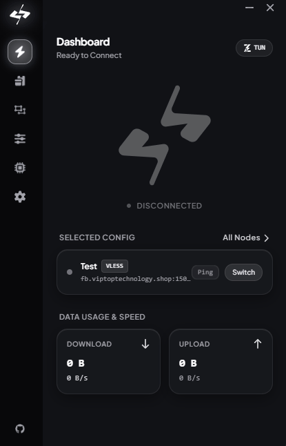

<div align="center">
  
  <h1>Byp</h1>
  <p>
    <strong>Lightweight Windows Xray &amp; V2Ray client with kernel-level per-app split tunneling powered by the Zeltun Rust engine.</strong>
  </p>
  <p>
    <strong><a href="https://github.com/devlsam/Byp/releases/latest">Download Latest Release (Windows x64)</a></strong>
    &nbsp;·&nbsp;
    <a href="#tun-engines">TUN Engines</a>
    &nbsp;·&nbsp;
    <a href="#connection-modes">Modes</a>
    &nbsp;·&nbsp;
    <a href="#architecture">Architecture</a>
    &nbsp;·&nbsp;
    <a href="#build-from-source">Build</a>
    &nbsp;·&nbsp;
    <a href="#support--donate">Donate</a>
  </p>
  <p>
    <sub>Windows 10 / 11 (x64) · Go + Wails v3 · In-Memory Xray-core · Zeltun (Rust TUN) · BUSL-1.1</sub>
  </p>
</div>

<p align="center">
  
</p>

## Why Byp

I built Byp around `xray-core` because existing Xray/V2Ray Windows clients kept getting in the way: sluggish interfaces, bloated CPU/RAM overhead, and no straightforward way to route different apps over VPN vs. direct internet.

If you play online games from regions like Iran, most games either work fine directly or need raw ISP latency—while **Discord UDP voice**, Telegram, or a browser still needs an encrypted tunnel. Enabling a full-system TUN spikes game ping and breaks local traffic, and writing manual JSON routing rules for ephemeral UDP ports breaks as soon as an app updates.

Byp solves that with visual, per-process split tunneling at the Windows kernel/socket boundary: wire `Discord.exe` to **VPN Tunnel** and leave games on **Direct Internet**, with no external proxy wrappers or manual route maintenance.

---

## TUN Engines

Byp embeds two interchangeable Layer-3 TUN engines:

- **Zeltun** *(default, recommended)* — A native TUN engine I wrote in **Rust** and open-sourced separately at **[devlsam/Zeltun](https://github.com/devlsam/Zeltun)**. Handles packet forwarding, socket PID matching, QUIC blocking, DNS/NRPT leak protection, LAN bypass, and Gaming UDP QoS with near-zero CPU overhead.
- **tun2socks** — Classic built-in Go `gVisor` TCP/IP stack kept available as an alternative engine (also supports Jumbo MTU up to `9000`).

| Capability | Zeltun (Rust, Default) | tun2socks (Go gVisor) |
| :--- | :--- | :--- |
| **Forwarding Engine** | Native Rust `zeltun.dll` | Go `gVisor` netstack |
| **Per-App Split Tunneling** | Global / Include / Exclude (Live hot-reload) | Global / Include / Exclude |
| **DNS & Leak Guard** | UDP:53 intercept, Windows NRPT Guard, Strict Anti-Leak, IPv6 Blackhole | Tunnel DNS routing |
| **Packet Controls** | Block QUIC (`UDP:443`), TCP MSS Clamp, Gaming UDP QoS, SNI Sniff, LAN Bypass | Configurable MTU (`1280`–`9000`) |
| **Live Telemetry** | Rx/Tx, Proxied vs. Direct split bytes, TCP/UDP session counts, drops | Basic throughput |

---

## Connection Modes

- **TUN** — Routes traffic through **Zeltun** (or `tun2socks`) and Byp's embedded `xray-core`, with full per-app split tunneling.
- **Upstream** — Runs **Zeltun** split tunneling in front of any external SOCKS5 proxy (`host:port`, with a pre-flight SOCKS5 probe). Use this when you want another VPN client or local SOCKS5 tunnel to inherit Byp's per-app split routing, without running Byp's Xray core.
- **System Proxy** — Configures Windows WinINET system proxy cleanly (and clears it automatically on exit or shutdown).
- **Core Only** — Runs the local in-memory Xray SOCKS5 listener on your configured port without touching adapters or Windows proxy settings.

---

## Key Capabilities

- **Visual Split Tunneling:** Connect executables between **VPN Tunnel** and **Direct Internet** on a node canvas, with 1-click presets (`Discord`, `Telegram`, `Chrome`, `Steam`), a live running-process scanner, or any `.exe` path. Rules match base process names so auto-updating apps (such as Discord version folders) never break, and changes take effect live without reconnecting.
- **Xray Protocol & Raw Config Support:** Supports `VLESS` (`XTLS-Reality`, `XTLS-Vision`), `VMess`, `Trojan`, `Shadowsocks`, transports (`TCP`, `WebSocket`, `gRPC`, plus `libxray` share-link parsing), Base64 subscriptions, TCP/URL ping testing, and full raw JSON editing.
- **TUN Presets & Custom DNS:** One-click `Balanced`, `Gaming` (`8 MB` ring, `300s` UDP timeout, Gaming QoS), and `Zero-Leak` (`Strict Split Anti-Leak`, NRPT, IPv6 blackhole, QUIC block) profiles, plus quick DNS presets (`Cloudflare`, `Google`, `Shecan`, `Electro`, `Quad9`, or manual).
- **Configurable Inbound & Lifecycle:** Editable local SOCKS5 inbound port, autostart with Windows, auto-connect on launch, tray minimization with automatic memory trimming, and built-in GitHub Releases auto-updater.

---

## Architecture

```
Windows Apps ──▶ Socket Attribution (iphlpapi.dll: GetExtendedTcpTable / GetExtendedUdpTable)
                    │
                    ├──▶ [Direct / Bypassed Apps] ──▶ Physical NIC (IP_UNICAST_IF) ──▶ Direct ISP
                    │
                    └──▶ [Tunneled Apps] ──▶ BYP-TUN Adapter ──▶ Zeltun (Rust) / tun2socks
                                                                         │
                                                     ┌───────────────────┴───────────────────┐
                                                     ▼                                       ▼
                                            Embedded Xray-core                    External Upstream SOCKS5
                                                (TUN Mode)                            (Upstream Mode)
```

- **Zero Bundled Browser Bloat:** Built with **Go** and **Wails v3**, using the native Windows Edge WebView2 runtime rather than shipping Chromium/Electron. Automatically trims Go heap and WebView2 working-set memory when hidden to the system tray.
- **In-Memory Single Binary:** `xray-core` runs directly inside the Go process with gRPC traffic stats—no external `xray.exe` console windows or orphaned background binaries.
- **Loop-Free Kernel Bypass:** Outbound direct sockets bind straight to your physical adapter's interface index (`setsockopt` with `IP_UNICAST_IF`), paired with static host routes for proxy server IPs so bypassed traffic never loops back into `BYP-TUN`.
- **Self-Healing Network Handling:** A runtime network watcher tracks physical adapter/gateway switches and updates live routes; shutdown and startup cleanup hooks remove leftover static routes, system proxy flags, and Windows NRPT rules automatically.

---

## Download & Run

1. Download the latest archive from **[GitHub Releases](https://github.com/devlsam/Byp/releases/latest)**.
2. Extract and run the executable as **Administrator** *(required by Windows to initialize the `BYP-TUN` Layer-3 adapter, manage interface routes, and apply NRPT DNS rules)*.
3. Import share links (`vless://`, `vmess://`, `trojan://`, `ss://`), a Base64 subscription URL, or raw Xray JSON.

*SmartScreen note: binary releases are unsigned, so click **More info -> Run anyway** if Windows prompts on first launch.*

---

## Build from Source

Prerequisites: **Go 1.27+**, **Node.js**, and **Wails v3 CLI**.

```bash
git clone https://github.com/devlsam/Byp.git
cd Byp
wails3 task build
```

`zeltun.dll` is embedded directly in `internal/tun/assets/` and extracted automatically at runtime. The compiled Windows executable is written to `bin/`.

If you want to build the TUN engine separately from source, clone [devlsam/Zeltun](https://github.com/devlsam/Zeltun), run `cargo build --release`, and copy `target/release/zeltun.dll` into `internal/tun/assets/zeltun.dll`.

---

## Support & Donate

If Byp lowered your game ping or simplified your setup, you can support the project here:

https://donatr.ee/devlsam/

- **Zeltun Rust Engine:** [devlsam/Zeltun](https://github.com/devlsam/Zeltun)
- **Bug Reports & Feature Requests:** [GitHub Issues](https://github.com/devlsam/Byp/issues)
- **Discord:** `amosami`

## License

Distributed under [BUSL-1.1](LICENSE).
