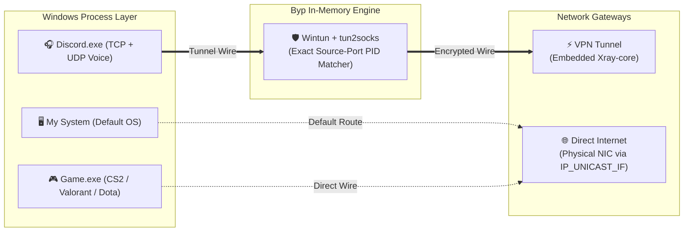

<div align="center">
  
  <h1>⚡ Byp</h1>
  <p>
    <b>The Ultra-Lightweight V2Ray & Xray Windows Client with Kernel-Level Split Tunneling & Gaming Performance Mode.</b>
  </p>
  <p>
    <i>Route Discord, Telegram, or any specific app through your encrypted proxy while keeping your games and entire PC on raw, low-ping direct ISP internet — visually, with zero manual routing headaches.</i>
  </p>

  <p>
    
    
    
    
    
    
  </p>

  <p>
    <a href="#-quick-download--installation">⚡ Quick Install</a> •
    <a href="#-overview-why-byp">📖 Overview</a> •
    <a href="#-key-features">✨ Key Features</a> •
    <a href="#-kernel-level-architecture">🛠️ Architecture</a> •
    <a href="#-comparison">📊 Comparison</a> •
    <a href="#-faq">❓ FAQ</a>
  </p>

  <p>
    <b>🌐 English</b> | <a href="README_FA.md"><b>🇮🇷 نسخه فارسی (Persian)</b></a>
  </p>
</div>

---

## ⚡ Quick Download & Installation

Get started with **Byp** in seconds — no complex installers, no background CLI bloat.

### Option 1: Direct Download (Recommended)

1. Download the latest release from the [**Releases**](https://github.com/devlsam/Byp/releases) page:
   - 📦 [**Download Latest `byp.exe` / `.zip`**](https://github.com/devlsam/Byp/releases/latest)
2. Extract and run **`byp.exe`** as **Administrator** *(required by Windows to create the Layer-3 `Wintun` virtual network adapter and manage process-level packet routes)*.
3. Import your configuration (`vless://`, `vmess://`, `trojan://`, `ss://` or Subscription link) and enjoy smooth gaming!

> [!TIP]
> **Windows SmartScreen Note:** As Byp is an independent project without an expensive corporate certificate, Windows Defender SmartScreen might show a prompt on initial launch. Click **"More info"** ➔ **"Run anyway"** to launch.

---

### Option 2: Building from Source

Prerequisites: **Go 1.25+**, **Node.js 22+**, and **Wails v3 CLI**.

```bash
# Clone the repository
git clone https://github.com/devlsam/Byp.git
cd Byp

# Install dependencies and build
go mod tidy
wails3 build -clean -s
```

The compiled native executable will be ready at `build/bin/byp.exe`.

---

## 📖 Overview: Why Byp?

<div align="center">
  
  <br/>
  <sub><i>⚡ Interactive Visual Flow: Wire apps directly to <b>VPN Tunnel</b> or <b>Direct Internet</b> on the fly with zero connection drop.</i></sub>
</div>

<br/>

### ❌ The Core Problem with Existing V2Ray / Xray Clients
For millions of gamers, developers, and everyday users, existing Windows V2Ray clients (v2rayN, NekoBox, etc.) force a frustrating compromise:

1. **System Proxy Fails for Gaming & Voice:** Apps like **Discord (WebRTC & UDP Voice)** and multiplayer games completely ignore Windows system proxy settings.
2. **Global TUN Destroys Game Ping:** Turning on full TUN mode forces **100% of your PC's network traffic** through the proxy. Your gaming ping spikes from 40ms to 200ms+, packet loss climbs, direct file downloads are throttled, and domestic websites/banking lock you out.
3. **Manual Routing Rules are an Exhausting Nightmare:** Setting up process routing in traditional clients requires writing tedious regex rules, digging through nested JSON files, hunting down ephemeral UDP ports, or maintaining fragile `.exe` path whitelists that break every time an app auto-updates.

### ✅ The Byp Solution: Kernel-Level Split Tunneling
**Byp** was built from the ground up to solve this exact problem:

- **Separates Traffic at the Kernel Boundary:** Before network packets can congest or re-route through user-space proxies, Byp inspects and attributes socket ownership at the Windows kernel level.
- **Game at 100% Native Ping While Discord Stays on VPN:** Keep `Discord.exe` (including voice chat) crystal-clear on your encrypted proxy, while your games (`Valorant`, `CS2`, `Dota 2`, `Call of Duty`, `Steam`) bypass the VPN entirely and run at direct physical ISP wire speeds.
- **Full Freedom of Veteran Clients:** No features stripped down. You get full support for every modern Xray protocol, subscription management, and complete freedom to inspect and edit raw JSON configs just like you're used to.

---

## ✨ Key Features

### 🎨 1. Modern, Sleek & Fluid UI
Ditch the cluttered, confusing interfaces from a decade ago. Byp features an ultra-responsive, dark matte aesthetic designed for speed and clarity. Smooth micro-interactions, clean visual feedback, and a frictionless experience make configuring proxies effortless.

### ⚡ 2. Kernel-Level Visual Split Tunneling
- **Visual Node Topology:** Inspired by modern flow-builders like n8n, simply wire applications between **`VPN Tunnel`** and **`Direct Internet`**.
- **1-Click Presets:** Instantly route popular apps with built-in pills for `Discord.exe`, `Telegram.exe`, `Chrome.exe`, `Steam.exe`, and more.
- **Live Process Scanner (`+ Running Apps`):** Scan active Windows processes directly from RAM, or browse for any `.exe` file on your system.
- **Update-Resilient Engine:** Routes based on the base executable name across child processes, so auto-updating apps (like Discord updating to `app-1.0.9xxx`) never lose their routing rules.
- **Zero-Restart Switching:** Flip an app's route instantly without dropping your active core connection.

### 🌐 3. Full Xray Protocol Fleet & Unrestricted JSON Editing
Supports every protocol, transport, and encryption scheme provided by `Xray-core`:
- **Protocols:** `VLESS` (`XTLS-Reality`, `XTLS-Vision`), `VMess`, `Trojan`, `Shadowsocks`, `WireGuard`.
- **Transports:** `TCP`, `WebSocket (WS)`, `gRPC`, `HTTPUpgrade`, `SplitHTTP`.
- **Subscriptions:** Automated Base64 subscription import and periodic updates.
- **Raw JSON Freedom:** Just like famous power-user clients, you have 100% open access to view, customize, and edit the underlying Xray JSON configurations. Your configs, your rules.

### 🛡️ 4. Custom DNS Routing & Anti-Poisoning Guard
- **Flexible DNS Routing:** Route DNS queries through custom upstream resolvers (Cloudflare, Google, custom DoH/DoT) or direct local gateways.
- **Eliminate Voice & WebRTC Errors:** Transparent DNS interception prevents ISP DNS poisoning, permanently eliminating Discord `RTC Connecting` and `No Route` voice glitches.

### 🔄 5. Direct GitHub Auto-Updater
Never worry about manually hunting for new releases. Byp includes an integrated background auto-updater hooked directly to the [devlsam/Byp](https://github.com/devlsam/Byp) repository. When a new update drops, download and restart right from the app with one click.

### 🚀 6. Auto-Connect on Launch & Boot Autostart
- **Seamless Startup:** Enable auto-connect so Byp immediately engages your active proxy and split-tunneling rules the moment the application opens or when Windows boots.
- **Zero-Friction Gaming:** Boot your PC, start your favorite game, and have Discord already routed through the proxy in the background without clicking a single button.

### 🎮 7. Gaming Performance Mode (~40MB RAM Footprint)
- **Engineered to be the Lightest Client Possible:** Built with native **Go** and **Wails v3**, utilizing the built-in Windows Edge WebView2 engine instead of dragging along a 300MB+ Chromium/Electron environment.
- **Single In-Memory Executable:** Both `xray-core` and `tun2socks` run natively in memory inside `byp.exe`. No annoying popup CLI windows, no orphan background processes, and negligible CPU impact during intense gaming sessions.

---

## 🛠️ Kernel-Level Architecture

Traditional user-space proxy wrappers fail with games and WebRTC because applications spin up hundreds of transient TCP and UDP sockets every minute. **Byp** delivers line-rate performance with zero per-packet CPU overhead:



1. **Exact Source-Port Attribution (`iphlpapi.dll`):** Packets entering the Layer-3 `Wintun` adapter have their original source ports inspected in the `gVisor` netstack *before* NAT translation. Byp queries Windows kernel socket tables (`GetExtendedTcpTable` & `GetExtendedUdpTable`) to pinpoint the owning PID in nanoseconds.
2. **Lock-Free Memory Cache:** Process image paths are mapped once during initial handshake via `QueryFullProcessImageNameW` and cached in a thread-safe `sync.Map`. All subsequent data packets flow at native wire speed.
3. **Hardware Layer-3 NIC Binding (`IP_UNICAST_IF`):** Packets designated for direct internet are locked to your physical network interface's `InterfaceIndex` at socket creation via `setsockopt(..., IP_UNICAST_IF)`, completely eliminating routing loops back into the TUN adapter.
4. **Crash-Safe Self-Healing:** Shutdown hooks instantly purge static routes, release the `Wintun` interface, and reset Windows system proxies upon exit. Your internet will never get stuck.

---

## 📊 Comparison

| Feature | ⚡ Byp | v2rayN | NekoRay / NekoBox | Proxifier + Xray |
| :--- | :---: | :---: | :---: | :---: |
| **Per-App Split Tunneling** | **Interactive Visual Canvas** | Nested text menus | Complex routing rules | External paid tool |
| **Discord Voice (UDP) Split** | **✅ 1-Click Preset** | ⚠️ Complex TUN config | ⚠️ Manual process rules | ⚠️ Manual port mapping |
| **Game Ping Protection** | **✅ Kernel NIC Binding** | ⚠️ Route table conflicts | ⚠️ Packet latency overhead | ❌ Not a tunnel client |
| **RAM Footprint (Idle)** | **~35 MB – 50 MB** | ~90 MB – 140 MB | ~110 MB – 160 MB | ~120 MB+ |
| **Core Architecture** | **In-Memory Go Binary** | Spawns external CLI .exe | Spawns external core .exe | Requires 2 separate apps |
| **App Update Tolerance** | **✅ Matches Base Executable** | ⚠️ Breaks on folder change | ⚠️ Breaks on folder change | ✅ Supported |
| **Auto-Connect on Launch** | **✅ Native Setting** | ⚠️ Varies | ⚠️ Manual | ❌ N/A |
| **Built-in Auto Updater** | **✅ Direct from GitHub** | ⚠️ Manual / Semi-auto | ⚠️ Manual download | ⚠️ Separate updater |
| **Raw JSON Config Freedom** | **✅ Full Freedom** | ✅ Supported | ⚠️ Limited in UI | ❌ N/A |

---

## 🗺️ Roadmap

- [x] In-memory `xray-core` + `tun2socks` (Wintun) single-binary architecture
- [x] Interactive node-based split tunneling for `.exe` applications
- [x] 1-Click quick presets (Discord, Telegram, Steam, Chrome) & live process scanner
- [x] Layer-3 physical NIC binding (`IP_UNICAST_IF`) for loop-free bypass
- [x] Auto-Connect on Launch & Windows autostart
- [x] Native GitHub Releases auto-updater
- [ ] Domain & GeoIP routing blocks inside visual topology
- [ ] Live per-application bandwidth and latency gauges on routing wires
- [ ] Profile presets (Switch between "Gaming Mode", "Work Mode", and "Full VPN")

---

## ❓ FAQ

<details>
<summary><b>Why is Byp the best V2Ray / Xray client for gaming on Windows?</b></summary>
<br/>
Because traditional clients route either your entire PC or rely on basic system proxies that ignore games and Discord UDP voice. Byp separates traffic at the kernel level using Wintun: Discord Voice stays encrypted and connected on your proxy, while games bypass the tunnel with 0ms added ping.
</details>

<details>
<summary><b>How does Discord Voice work without "RTC Connecting" or "No Route" errors?</b></summary>
<br/>
Discord voice transmits over WebRTC via dynamic UDP ports. Byp's kernel attribution resolves Discord's UDP sockets instantly and tunnels them through Layer-3 TUN directly into the core, eliminating voice connection drops for good.
</details>

<details>
<summary><b>Does Byp require Administrator privileges?</b></summary>
<br/>
Yes. Initializing the <code>Wintun</code> Layer-3 virtual network adapter and binding network sockets directly to physical NICs require standard Windows Administrator privileges.
</details>

<details>
<summary><b>Do auto-updates for Discord or Telegram break my routing rules?</b></summary>
<br/>
No. Byp evaluates rules against the base process name (e.g. <code>Discord.exe</code>) across all child processes, regardless of whether Discord updates into a new directory like <code>app-1.0.9042</code>.
</details>

<details>
<summary><b>Can I edit raw Xray JSON configs like in v2rayN?</b></summary>
<br/>
Yes! You have full access to inspect, modify, and tweak outbounds, inbounds, and routing JSON definitions directly.
</details>

---

## 🤝 Community & Support

- **GitHub Repository:** [devlsam/Byp](https://github.com/devlsam/Byp)
- **Bug Reports & Feature Requests:** [GitHub Issues](https://github.com/devlsam/Byp/issues)
- **Discord:** `amosami`

If **Byp** solved your gaming ping and split tunneling headaches, please consider giving this repo a **⭐ Star** to support ongoing development!

---

## 📄 License

Distributed under the [Business Source License 1.1 (BUSL-1.1)](LICENSE).