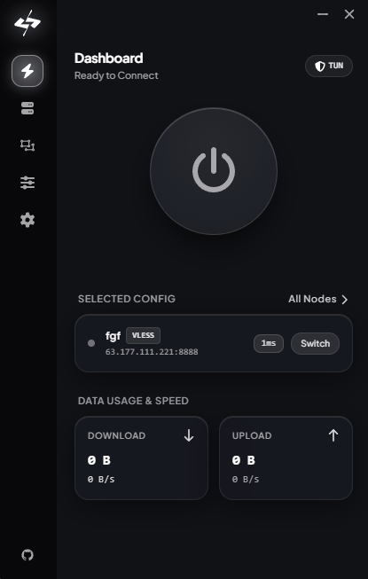
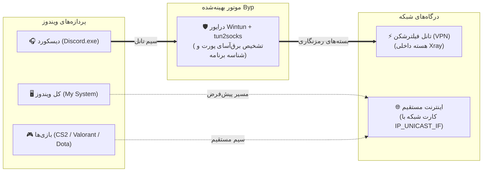

<div dir="rtl" align="center">
  
  <h1>⚡ Byp</h1>
  <p>
    <b>کلاینت فوق‌العاده سبک V2Ray و Xray برای ویندوز — با اسپلیت تانلینگ واقعی در سطح کرنل و حالت مخصوص گیمینگ.</b>
  </p>
  <p>
    <i>دیسکورد، تلگرام یا هر برنامه‌ای که خواستی رو با فیلترشکن رد کن، بازی‌هاتم با همون پینگ فابریک اینترنتت بازی کن؛ بدون دردسر روتینگ و کانفیگ‌های دستی، فقط با کشیدن یک خط!</i>
  </p>

  <p>
    
    
    
    
    
    
  </p>

  <p>
    <a href="#-دانلود-و-نصب-سریع">⚡ دانلود و نصب سریع</a> •
    <a href="#-داستان-ما-چرا-اصلا-byp-رو-ساختیم؟">📖 چرا Byp؟</a> •
    <a href="#-امکانات-و-ویژگی‌های-اصلی">✨ امکانات اصلی</a> •
    <a href="#-زیر-کاپوت-چی-میگذره؟-معماری-در-سطح-کرنل">🛠️ زیر کاپوت برنامه</a> •
    <a href="#-مقایسه-با-بقیه-کلاینت‌ها">📊 مقایسه</a> •
    <a href="#-سوالات-متداول">❓ سوالات متداول</a>
  </p>

  <p>
    <a href="README.md"><b>🌐 English</b></a> | <b>🇮🇷 نسخه فارسی</b>
  </p>
</div>

---

<div dir="rtl">

## ⚡ دانلود و نصب سریع

کار با **Byp** فوق‌العاده سادس؛ نه نصاب چندمرحله‌ای داره و نه فایل‌های به درد نخور.

### روش اول: دانلود مستقیم نسخه آماده (پیشنهاد ما)

1. آخرین نسخه رو از صفحه ریلیزها دانلود کن:
   - 📦 [**دانلود مستقیم فایل `byp.exe` یا زیپ**](https://github.com/devlsam/Byp/releases/latest)
2. روی فایل **`byp.exe`** راست‌کلیک کن و **Run as Administrator** رو بزن *(ویندوز برای کارت شبکه مجازی `Wintun` و اینکه بتونه ترافیک برنامه‌ها رو تفکیک کنه، دسترسی ادمین میخواد)*.
3. کانفیگت (`vless://`، `vmess://`، `trojan://`، `ss://`) یا **لینک سابت** رو پیست کن، دیسکوردت رو وصل کن و برو تو گیم!

> [!TIP]
> **اخطار SmartScreen ویندوز:** از اونجا که Byp یه پروژه مستقله و ما چند هزار دلار پول ندادیم به مایکروسافت واسه سرتیفیکیت رسمی، ویندوز دفندر ممکنه اولش اخطار بده. خیلی راحت روی **"More info"** و بعد **"Run anyway"** کلیک کن.

---

### روش دوم: بیلد از سورس کد (برای برنامه‌نویس‌ها)

پیش‌نیازها: **Go 1.25+**، **Node.js 22+** و **Wails v3 CLI**.

```bash
git clone https://github.com/devlsam/Byp.git
cd Byp

go mod tidy
wails3 build -clean -s
```

فایل نهایی توی مسیر `build/bin/byp.exe` ساخته میشه.

---

## 📖 داستان ما: چرا اصلاً Byp رو ساختیم؟

<div align="center">
  
  <br/>
  <sub><i>⚡ محیط بصری اسپلیت تانلینگ: برنامه‌ها رو فقط با کشیدن یک خط بین فیلترشکن و نت مستقیم جابجا کن، بدون قطعی اتصال!</i></sub>
</div>

<br/>

### ❌ معضل همیشگی ما با کلاینت‌های دیگه (مثل v2rayN یا NekoBox)
احتمالاً بارها برات پیش اومده که وسط بازی با رفقا توی دیسکورد بودی و یکی از این سه تا بلا سرت اومده:

1. **پراکسی معمولی که اصلاً به درد گیم و دیسکورد نمیخوره:** پروکسی معمولی ویندوز (System Proxy) ترافیک UDP رو رد نمیکنه. یعنی وارد دیسکورد میشی ولی ویس وصل نمیشه و هی روی `RTC Connecting` گیر میکنه.
2. **روشن کردن تانل (TUN) پینگ بازی رو داغون میکنه:** توی کلاینت‌های دیگه تا دکمه تانل رو میزنی، کل اینترنت سیستمت میره زیر فیلترشکن. پینگت توی ولورانت و سی‌اس از ۴۰ میپره رو ۲۰۰، پکت‌لاس میگیری، سرعت دانلود نصف میشه و سایت‌های بانکی و دانشگاهی هم ارور میدن!
3. **درگیر شدن با منوهای پیچیده و روتینگ دستی:** کی واقعاً حوصله داره بره توی کلاینت‌ها رول‌های متنی عجیب بنویسه، پورت‌های دیسکورد رو حدس بزنه، یا آدرس فایل‌های `.exe` رو پیدا کنه؟ تازه تا دیسکورد یه آپدیت میده و فولدرش عوض میشه، کل زحماتت میپره و دوباره باید از اول تنظیم کنی!

### ✅ راه‌حل Byp: اسپلیت تانلینگ واقعی در سطح کرنل
ما **Byp** رو ساختیم که این ماجرا برای همیشه تموم بشه:

- **تفکیک ترافیک تو لایه کرنل ویندوز:** برنامه قبل از اینکه ترافیک بخواد تاخیری ایجاد کنه یا بازی رو سنگین کنه، بسته‌های شبکه رو درجا شناسایی و تفکیک می‌کنه.
- **بازی با پینگ فابریک نت خودت، دیسکورد با فیلترشکن:** ویس دیسکوردت با بهترین کیفیت و بدون قطعی روی تانل میمونه، بازی‌هاتم (`Valorant`, `CS2`, `Dota 2`, `Call of Duty`, `Steam`) بدون حتی ۱ میلی‌ثانیه افزایش پینگ، از نت مستقیم خودت رد میشن.
- **همون امکانات کلاینت‌های محبوب با دست کاملاً باز:** تمام آپشن‌های حرفه‌ای سر جاشه؛ ساپورت همه پروتکل‌های Xray، آپدیت راحت لینک ساب، و امکان دستکاری کامل و دستی فایل JSON کانفیگ.

---

## ✨ امکانات و ویژگی‌های اصلی

### 🎨 ۱. رابط کاربری مدرن، دارک و فوق‌العاده نرم
از ظاهر شلوغ و منوهای قدیمی کلاینت‌های ده سال پیش فاصله گرفتیم. یک محیط دارک مات و مدرن که کار کردن باهاش سریع، ساده و لذت‌بخشه.

### ⚡ ۲. اسپلیت تانلینگ بصری و ۱ کلیکی
- **سیم‌کشی گرافیکی برنامه‌ها:** مثل ابزارهای نودمحور مدرن (سبک n8n)، با کشیدن یک خط ساده تعیین می‌کنی کدوم برنامه بره روی **VPN Tunnel** و کدوم بمونه روی **Direct Internet** (اینترنت مستقیم).
- **دکمه‌های آماده و دم دستی:** با یک کلیک `Discord.exe`، `Telegram.exe`، `Chrome.exe`، `Steam.exe` و بقیه رو به مسیر دلخواهت بفرست.
- **اسکنر برنامه‌های باز (`+ Running Apps`):** لازم نیست دنبال فایل برنامه‌ها بگردی؛ برنامه‌های باز سیستمت رو توی لیست نشون میده تا با یه کلیک اضافه‌شون کنی.
- **ضد ضربه در برابر آپدیت برنامه‌ها:** وقتی دیسکورد آپدیت میده و اسم پوشه‌اش عوض میشه (`app-1.0.9xxx`)، Byp با اسم اصلی برنامه چکش می‌کنه و روتینگت هیچ‌وقت به هم نمی‌ریزه.
- **جابجایی مسیر در لحظه:** وسط چت یا بازی، مسیر برنامه رو عوض کن بدون اینکه کانکشن فیلترشکنت قطع بشه یا نیاز به ریستارت باشه.

### 🌐 ۳. پشتیبانی از تمام پروتکل‌های Xray + آزادی کامل در ادیت JSON
هر پروتکل و ترنسپورتی که هسته Xray پشتیبانی کنه توی Byp با نهایت سرعت کار می‌کنه:
- **پروتکل‌ها:** `VLESS` (همراه با قابلیت‌های ضدفیلتر `Reality` و `Vision`)، `VMess`، `Trojan`، `Shadowsocks` و `WireGuard`.
- **ترنسپورت‌ها:** `TCP`، `WebSocket (WS)`، `gRPC`، `HTTPUpgrade`، `SplitHTTP`.
- **پشتیبانی از لینک‌های ساب (Subscription):** اضافه کردن راحت لینک ساب، آپدیت خودکار و سوییچ سریع بین کانفیگ‌ها.
- **دستِ کاملاً باز برای ادیت فایل JSON کانفیگ:** دقیقاً مثل کلاینت‌های حرفه‌ای، می‌تونی سورس کامل JSON کانفیگ رو باز کنی، پارامترها و روتینگ رو دستی تغییر بدی و ذخیره کنی؛ هیچ محدودیتی نداری.

### 🛡️ ۴. تنظیمات کامل DNS و حل مشکل قطعی ویس دیسکورد
- **روتینگ سفارشی DNS:** قابلیت تغییر DNS سرورها (کلادفلر، گوگل یا DoH/DoT دلخواه) برای جلوگیری از خرابکاری و دستکاری DNS توسط اپراتورها.
- **خداحافظی با خطای RTC Connecting دیسکورد:** ترافیک DNS برنامه‌ها بدون اینکه دچار آلودگی و فیلترینگ بشه رد میشه تا ارورهای همیشگی دیسکورد مثل `RTC Connecting` و `No Route` برای همیشه ناپدید بشن.

### 🔄 ۵. آپدیت خودکار مستقیم از همین ریپازیتوری
دیگه لازم نیست دنبال لینک‌های دانلود تلگرام یا سایت‌های مختلف بگردی. Byp مستقیماً به همین ریپازیتوری ([devlsam/Byp](https://github.com/devlsam/Byp)) وصله و هر وقت نسخه جدیدی بیاد، با یک کلیک خودش رو آپدیت می‌کنه.

### 🚀 ۶. اتصال خودکار به محض باز شدن برنامه (Auto-Connect)
- **روشن کن و برو تو بازی:** می‌تونی گزینه Auto-Connect رو فعال کنی تا به محض بالا اومدن ویندوز یا باز کردن Byp، آخرین کانفیگ وصل بشه و روتینگت فعال باشه. نیازی نیست هر بار دستی دکمه Connect رو بزنی.

### 🎮 ۷. حالت پرفورمنس گیمینگ (مصرف رم در حد ۴۰ مگابایت!)
- **سبک‌ترین کلاینت ویندوز:** بدون استفاده از فریم‌ورک‌های سنگین و باتری‌خور مثل الکترون که الکی ۳۰۰-۴۰۰ مگابایت رم می‌بلعن؛ با زبان سریع **Go** و وب‌ویوی سبک خود ویندوز نوشته شده.
- **هسته ۱۰۰٪ درونی (In-Memory Single Binary):** هر دو هسته `xray-core` و `tun2socks` مستقیماً داخل رم باینری `byp.exe` کار می‌کنن. هیچ پنجره سیاه کنسول CMD وسط بازی باز نمیشه، هیچ پروسس مخفی و آویزونی نمی‌مونه و مصرف CPU عملاً صفره.

---

## 🛠️ زیر کاپوت چی میگذره؟ (معماری در سطح کرنل)

برنامه‌های عادی توی بازی‌ها و ویس چت کم میارن چون بازی‌ها در هر ثانیه صدها پورت مختلف باز و بسته می‌کنن. Byp این پردازش رو در سریع‌ترین حالت ممکن و در لایه شبکه ویندوز انجام میده:



1. **شناسایی دقیق پورت مبدا (`iphlpapi.dll`):** وقتی بسته‌ای وارد کارت شبکه مجازی Wintun میشه، Byp پورت فرستنده رو مستقیم از کرنل ویندوز استعلام می‌کنه تا بفهمه دقیقاً متعلق به کدوم برنامه (مثلاً Discord یا بازی) بوده.
2. **کش درجا توی رم:** مشخصات برنامه فقط بار اول خونده میشه و در رم کش میشه؛ بقیه بسته‌ها با نهایت سرعت کارت شبکه‌ات عبور می‌کنن و هیچ افت FPS یا لگی حس نمیکنی.
3. **اتصال مستقیم به کارت شبکه فیزیکی (`IP_UNICAST_IF`):** ترافیکی که قراره فیلترشکن نخوره، مستقیم به کارت شبکه اصلی سیستمت (وای‌فای یا کابل LAN) قفل میشه تا هیچ‌وقت درگیر لوپ و تاخیر نشه.
4. **تمیزکاری خودکار شبکه موقع خروج (Self-Healing):** هر وقت Byp رو ببندی، تمام روت‌ها و تنظیمات شبکه در جا به حالت اول برمی‌گردن تا اینترنتت بعد بستن برنامه قطع نمونه یا گیر نکنه.

---

## 📊 مقایسه با بقیه کلاینت‌ها

| قابلیت | ⚡ Byp | v2rayN | NekoRay / NekoBox | Proxifier + Xray |
| :--- | :---: | :---: | :---: | :---: |
| **اسپلیت تانلینگ برنامه‌ها** | **محیط بصری و ۱ کلیکی** | منوهای متنی و تو در تو | رول‌های متنی پیچیده | نرم‌افزار جداگانه و پولی |
| **تفکیک ویس دیسکورد (UDP)** | **✅ ۱ کلیک با دکمه آماده** | ⚠️ تنظیمات پیچیده TUN | ⚠️ رول‌نویسی دستی پروسس | ⚠️ پورت‌بندی دستی |
| **حفظ پینگ و سرعت بازی** | **✅ اتصال مستقیم سخت‌افزاری** | ⚠️ تداخل روتینگ ویندوز | ⚠️ تاخیر و لگ روی بسته‌ها | ❌ تانل سیستم نیست |
| **مصرف رم در حالت بیکار** | **~۳۵ تا ۵۰ مگابایت** | ~۹۰ تا ۱۴۰ مگابایت | ~۱۱۰ تا ۱۶۰ مگابایت | ~۱۲۰ مگابایت به بالا |
| **روش اجرای هسته** | **توکار در رم (Go Binary)** | باز کردن فایل exe فرعی | باز کردن هسته فرعی | نیاز به دو برنامه همزمان |
| **سازگاری با آپدیت نرم‌افزارها** | **✅ تشخیص با اسم فایل** | ⚠️ با جابجایی فولدر می‌پره | ⚠️ نیازمند تنظیم مجدد | ✅ پشتیبانی می‌کند |
| **اتصال خودکار با شروع ویندوز** | **✅ تنظیم ساده داخل برنامه** | ⚠️ متغیر | ⚠️ دستی | ❌ ندارد |
| **آپدیت خودکار برنامه** | **✅ مستقیم از گیت‌هاب** | ⚠️ دستی یا نیمه‌خودکار | ⚠️ دانلود دستی فایل | ⚠️ آپدیتر جداگانه |
| **آزادی در ویرایش JSON کانفیگ** | **✅ دستِ کاملاً باز** | ✅ پشتیبانی می‌کند | ⚠️ محدود در UI | ❌ ندارد |

---

## 🗺️ برنامه‌های آینده (Roadmap)

- [x] هسته تک‌فایلی و یکپارچه بدون پنجره‌های مزاحم CMD
- [x] اسپلیت تانلینگ گرافیکی و نودمحور برای برنامه‌های ویندوز
- [x] دکمه‌های آماده دیسکورد، تلگرام، استیم و کروم + اسکنر زنده برنامه‌های باز
- [x] اتصال مستقیم به کارت شبکه اصلی برای پینگ صفر در بازی‌ها
- [x] قابلیت اتصال خودکار موقع بالا اومدن سیستم (Auto-Connect)
- [x] آپدیت خودکار مستقیم از ریلیزهای رسمی گیت‌هاب
- [ ] اضافه کردن نودهای روتینگ دامنه‌ها و سایت‌های ایرانی در صفحه بصری
- [ ] نمایش زنده مصرف پهنای باند و پینگ روی سیم‌های روتینگ
- [ ] پروفایل‌های آماده (جابجایی سریع بین "حالت گیمینگ"، "حالت کار" و "تانل کامل")

---

## ❓ سوالات متداول

<details>
<summary><b>چرا Byp بهترین گزینه برای گیمرهاست؟</b></summary>
<br/>
چون بر خلاف بقیه برنامه‌ها که یا کل سیستم رو می‌برن زیر فیلترشکن (و پینگ بازی نابود میشه) یا فقط به مرورگر پروکسی میدن (که دیسکورد کار نمیکنه)، Byp در سطح کرنل کار رو تموم می‌کنه: دیسکوردت آزاده، بازیتم با پینگ فابریک نت خودت وصله!
</details>

<details>
<summary><b>چرا با دیسکورد ارورهای RTC Connecting یا No Route نمی‌گیریم؟</b></summary>
<br/>
ویس دیسکورد از پروتکل WebRTC و بسته‌های متغیر UDP استفاده می‌کنه. سیستم هوشمند Byp پورت‌های UDP دیسکورد رو در جا شناسایی می‌کنه و از هسته رد میکنه تا قطعی ویس کاملاً ریشه‌کن بشه.
</details>

<details>
<summary><b>چرا برنامه به Run as Administrator نیاز داره؟</b></summary>
<br/>
برای ساخت کارت شبکه مجازی Wintun و اینکه برنامه‌ها بتونن مستقیم به کارت شبکه اصلی متصل بشن، ویندوز دسترسی ادمین رو الزامی کرده.
</details>

<details>
<summary><b>اگر دیسکورد یا تلگرام آپدیت بشن، تنظیماتم به هم می‌ریزه؟</b></summary>
<br/>
اصلاً. Byp مسیرهای تو در توی دیسکورد رو مانیتور نمیکنه، بلکه اسم فایل اصلی (مثل <code>Discord.exe</code>) رو توی پروسس‌ها شناسایی میکنه؛ پس هر چقدر دیسکورد آپدیت بده، تنظیماتت سر جاشه.
</details>

<details>
<summary><b>می‌تونم فایل خام JSON کانفیگ رو دستی ادیت کنم؟</b></summary>
<br/>
بله! دستت کاملاً بازه و می‌تونی تمام بخش‌های JSON شامل Outbounds، Inbounds و Routing رو دستکاری و شخصی‌سازی کنی.
</details>

---

## 🤝 ارتباط و حمایت از پروژه

- **ریپازیتوری گیت‌هاب:** [devlsam/Byp](https://github.com/devlsam/Byp)
- **گزارش باگ‌ها و پیشنهادات:** [بخش Issues گیت‌هاب](https://github.com/devlsam/Byp/issues)
- **ارتباط در دیسکورد:** `amosami`

اگر **Byp** حال دیسکورد و پینگ بازی‌هات رو بهتر کرده، حتماً با زدن دکمه **⭐ Star** بالای همین صفحه گیت‌هاب از پروژه حمایت کن تا بقیه بچه‌ها و گیمرها هم پیداش کنن!

---

## 📄 لایسنس

این پروژه تحت لایسنس [Business Source License 1.1 (BUSL-1.1)](LICENSE) منتشر شده؛ استفاده شخصی، آموزشی و برای گیم و کاربری عادی برای همه کاملاً آزاد و رایگانه.

</div>
